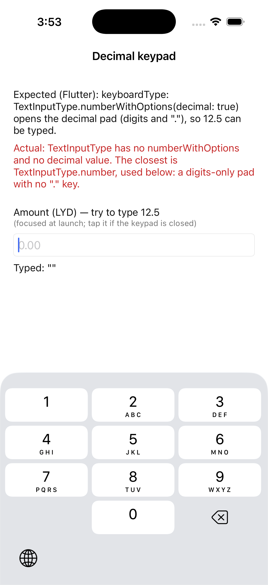
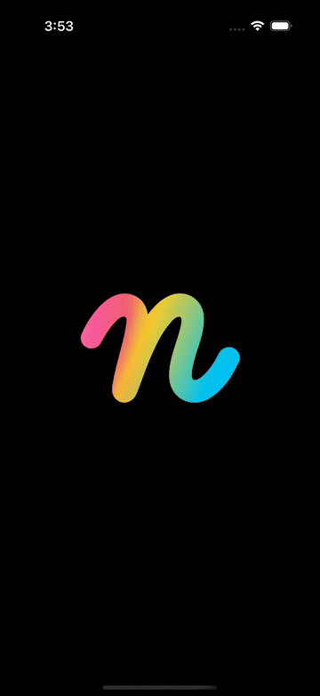

# Repro: no decimal keypad for TextField (`TextInputType.numberWithOptions` / `decimal` missing)

Issue: https://github.com/DartNative/dartnative/issues/58

`TextInputType` in DartNative 1.0.0 is an enum with no `numberWithOptions(decimal:, signed:)` and no `decimal` value. The closest, `TextInputType.number`, opens the iPhone's digits-only number pad, which has no decimal separator key. Any amount field (prices, payments, distances) can't take a value like `12.5` on an iPhone without a hardware keyboard.

## Run

`dn run` (iOS simulator; Android behaves the same unless stated).

## What you'll see

1. A labelled "Amount (LYD)" field with `keyboardType: TextInputType.number` (the field has `autofocus: true`, so the keypad opens at launch; tap the field if it is closed).
2. The keypad shows 0–9 and backspace only. There is no "." key, so `12.5` can't be typed.

## Expected

As in Flutter: `TextInputType.numberWithOptions(decimal: true)` opens the decimal pad (`UIKeyboardType.decimalPad` on iOS: digits plus the locale's separator; `TYPE_NUMBER_FLAG_DECIMAL` on Android).

## What we'd write in Flutter

```dart
TextField(
  keyboardType: const TextInputType.numberWithOptions(decimal: true),
  decoration: const InputDecoration(labelText: 'Amount (LYD)'),
)

// signed amounts
TextField(keyboardType: const TextInputType.numberWithOptions(decimal: true, signed: true))
```

On 1.0.0 both fail to compile: `numberWithOptions` isn't defined for `TextInputType`.

## Recording



 · [mp4](recording/ios.mp4)

## Environment

- DartNative 1.0.0 (SDK `113c27aacb2`, framework edition `7ae29132`), Dart 3.12.0
- macOS 26.7.1, Xcode 26.1.1
- iPhone 17 simulator, iOS 26.1
